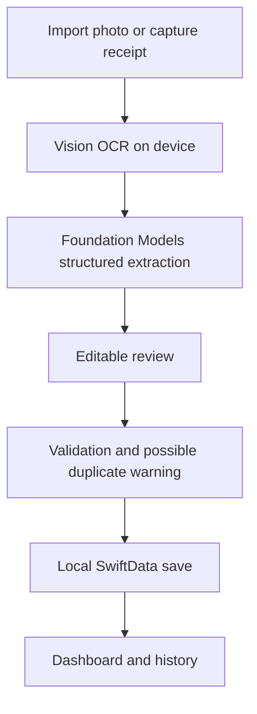

# FinanceTracker

FinanceTracker is a native iOS personal finance app for recording purchases, tracking monthly spending, and planning recurring bills. Receipt recognition, AI suggestions, and saved financial data stay on the device.

Add an expense in seconds, import or photograph a receipt, review the extracted details, and see how purchases and paid bills contribute to your budget. No online account or external AI API key is required.

## Contents

- [Features](#features)
- [Privacy and local storage](#privacy-and-local-storage)
- [Requirements](#requirements)
- [Getting started](#getting-started)
- [Using the app](#using-the-app)
- [How spending and budgets work](#how-spending-and-budgets-work)
- [Receipt processing](#receipt-processing)
- [Project structure](#project-structure)
- [Architecture and data model](#architecture-and-data-model)
- [Testing](#testing)
- [Pre-push checks and CI](#pre-push-checks-and-ci)
- [Troubleshooting](#troubleshooting)
- [Current limitations](#current-limitations)
- [Development guidelines](#development-guidelines)

## Features

| Area | Available behavior |
| --- | --- |
| Dashboard | Prominent Quick expense and Add receipt actions, monthly spending, comparable-period change, recurring expenses, and budget status |
| Quick expenses | Amount-only entry with optional description, category, currency, date, and split flag |
| Receipt import | Import a photo or capture one with the camera, recognize text locally, and review structured results before saving |
| Manual receipts | Enter a purchase and its items without a receipt photo |
| Item suggestions | Editable categories, Need/Want classifications, and grocery food labels from on-device analysis |
| History and insights | Monthly purchase history, six- or twelve-month spending trends, category totals, and grocery spending mix |
| Recurring expenses | Manually entered daily or monthly expenses, paid/unpaid tracking, and budget reservations for unpaid bills |
| Duplicate detection | Warn about matching merchant, date, currency, and total, with an explicit option to save anyway |
| Split tracking | Flag purchases or paid bills for later splitting; view pending and resolved history |
| Profile | Optional name, email, and phone number; selectable colorful animal avatars |
| Appearance | System, Light, and Dark modes; brief animated F-logo launch screen with Reduce Motion support |
| Onboarding | Optional first-launch setup with a skip option |

Categories currently include Uncategorized, Groceries, Dining, Household, Transport, Health, Entertainment, Gifts, and Other.

## Privacy and local storage

Privacy is a core implementation choice:

- Apple Vision recognizes receipt text on the device.
- Apple's Foundation Models framework provides on-device structured extraction and classification suggestions.
- SwiftData stores receipts, items, budgets, profiles, recurring schedules, and paid bill records locally.
- CloudKit synchronization is explicitly disabled.
- The local SwiftData storage directory is marked as excluded from device backups.
- The app does not upload receipt photos or text, call external AI APIs, or include analytics.
- Profile information is optional and does not create or verify an online account.

The app persists structured purchase details; it does not currently maintain an archive of original receipt photos. Photos selected from the system library remain subject to the user's Photos and iCloud Photos settings.

**Data recovery:** cloud synchronization and an app-level export/restore feature are not available. Because the app's data store is excluded from backups, do not rely on a device backup to recover its financial records. Deleting the app can remove its local data.

If local storage cannot be opened, the app displays an error instead of resetting the saved store.

## Requirements

| Requirement | Project configuration |
| --- | --- |
| Development environment | macOS with Xcode 27 and its iOS SDK |
| Deployment target | iOS 27.0 |
| Language | Swift; targets currently use Swift 5 language mode |
| UI and charts | SwiftUI and Swift Charts |
| Persistence | SwiftData |
| Text recognition | Vision |
| Structured AI extraction | Foundation Models |
| Test scripts | Bash, Python 3, and Xcode command-line tools |

Automatic receipt analysis requires a device on which Apple's on-device language model reports itself as available. An eligible operating system alone does not guarantee model availability. The Receipts screen automatically checks availability and provides an explanation when tapped.

Manual receipt entry, quick expenses, budgets, and recurring expense management remain useful when the model is unavailable. Simulator testing does not establish that real on-device AI extraction works.

There are no third-party package dependencies or API credentials to configure.

## Getting started

1. Obtain a local checkout of this repository.
2. Open `FinanceTracker.xcodeproj` in Xcode.
3. Select the shared **FinanceTracker** scheme.
4. In **Signing & Capabilities**, select your development team for both the app and test targets. The project contains an existing development-team setting; replace it for your own account. Adjust bundle identifiers if needed.
5. Connect and unlock your iPhone, trust the Mac, and enable Developer Mode.
6. Select the iPhone as the run destination and choose **Product > Run** (`Cmd+R`).

On first launch, complete the optional profile setup or skip directly to the app. Existing saved data bypasses first-launch setup.

For terminal commands, select the full Xcode developer directory when necessary:

```sh
export DEVELOPER_DIR=/Applications/Xcode.app/Contents/Developer
```

The supplied test scripts also handle a CommandLineTools-only selection when Xcode is installed at that location.

### Build without installing

From the repository root:

```sh
xcodebuild -project FinanceTracker.xcodeproj \
  -scheme FinanceTracker \
  -configuration Release \
  -destination 'generic/platform=iOS' \
  -derivedDataPath DerivedData/Tests \
  CODE_SIGNING_ALLOWED=NO build
```

This verifies Release compilation without signing or installing the app. Running on a physical device still requires signing.

## Using the app

### Add a quick expense

Open **Dashboard > Quick expense** or use the Quick expense action on the Receipts page. Enter a positive amount and save. A description, category, currency, purchase date, and **Needs splitting** flag can be supplied when useful.

The date defaults to today and the category to Uncategorized. The dashboard entry uses its selected currency. An amount-only expense is saved with the description “Quick expense.”

### Import or photograph a receipt

Choose **Dashboard > Add receipt**, then **Import photo**, **Take photo**, or **Enter manually**. The same receipt actions are available on the Receipts page.

For a photo, the app reads the text, analyzes the purchase details, and opens review. Correct the merchant name, date, total, or item information as needed, then save. The review screen keeps subtotal, tax, and internal validation checks out of the main customer flow. Save remains available; invalid required values are reported when saving.

Camera access requires permission. If it is denied, the camera flow offers a way to open Settings.

### Review spending

The dashboard shows current-month spending and a comparison with the same elapsed period of the previous month. Detailed category information, grocery spending mix, trends, and monthly history open through separate links to keep the main screen concise.

Search saved purchases by store or description on the Receipts page. Open a purchase to inspect its details, change classification fields, manage its split status, or delete it. Monthly history also supports deleting entries.

### Manage recurring expenses

Tap the **Recurring expenses** card and create a schedule for rent, utilities, subscriptions, or another fixed-cost expense. Choose a daily or monthly frequency, amount, currency, first due date, and optional end date.

Mark occurrences paid when payment happens. Unpaid current-month occurrences reserve budget capacity; paid records contribute to actual spending. A schedule can also flag its future paid records for splitting.

### Track expenses to split

Enable **Needs splitting** during entry or on a saved purchase. Open **Split expenses** on the dashboard to see pending purchases and paid bills. Mark an entry resolved after handling the split, or reopen it later.

This is a tracking list. It does not calculate each person's share or record reimbursements, and flagging an expense does not reduce its recorded spending amount.

### Customize your profile

Use **Profile** to save optional personal information, choose an animal avatar, or switch between System, Light, and Dark appearance. Profile details stay local.

## How spending and budgets work

These rules keep the dashboard, history, and budget views consistent:

- **Actual spending** includes saved purchases and recurring bill payments. Purchases use their purchase date; paid bills use their payment date.
- **Future calendar dates** are excluded from spending summaries until that day arrives.
- **Currencies remain separate.** The app does not perform exchange-rate conversion.
- **Monthly comparisons** use the same elapsed days in the previous month, adjusted for shorter months.
- **Budget commitments** equal actual spending plus unpaid scheduled bills for the current month.
- **Available after bills** equals the monthly budget minus those commitments.
- Marking a scheduled bill paid replaces its reservation with actual spending, avoiding double counting.
- Monthly due dates are anchored to the original schedule and clamp to the last day of a shorter month.
- Paid bills retain snapshots of their name, amount, category, and currency. Removing a schedule preserves its paid history.
- Category totals use item charges. Tax, adjustments, or amounts without item allocation are displayed separately so totals reconcile.
- Grocery percentages use positive grocery item spending, with Healthy, Junk, and Unclassified labels. They exclude tax and discounts and estimate purchase composition rather than personal health or nutrition.

Monetary values are persisted as integer cents. Summary calculations and display conversion use `Decimal` rather than binary floating-point money arithmetic.

## Receipt processing



`ReceiptImportService` coordinates OCR and extraction, propagates failures, and checks cancellation between stages. OCR groups nearby text blocks into approximate rows to help associate item names with prices.

`ReceiptAIService` uses a fresh model session for each receipt and typed `@Generable` output. Its instructions ask the model to:

- Prefer merchant evidence in the header, then inspect the rest of the receipt for identifying business names or website text.
- Avoid confusing product brands, payment providers, or third-party survey sites with the merchant.
- Extract printed charges without inventing missing values or changing amounts to force agreement.
- Suggest editable categories and classifications, leaving unclear items unclassified.

This approach does not contain merchant-specific Target matching. A logo alone may still provide insufficient text evidence, so the user can correct the merchant during review.

Possible duplicates match normalized merchant name, calendar day, currency, and total. A match is a warning rather than proof, so the user can choose **Save anyway**. Anonymous amount-only quick expenses bypass this warning to avoid treating unrelated identical amounts as duplicates.

In Debug builds, an **Extracted text from receipt** disclosure supports OCR investigation. It is excluded from Release builds.

## Project structure

```text
FinanceTracker/
├── App/                       # App entry, root navigation, theme, local storage
├── Models/                    # SwiftData entities and classification enums
├── Features/
│   ├── Dashboard/             # Spending summaries, budgets, charts, history
│   ├── Expenses/              # Quick expense entry and saving
│   ├── Onboarding/            # Optional first-launch profile setup
│   ├── Profile/               # Profile editing, appearance, avatar selection
│   ├── Receipts/              # Saved purchases, manual entry, detail screens
│   │   └── Import/            # Camera, OCR, AI extraction, review, validation
│   ├── Recurring/             # Schedules, paid records, budget reservations
│   └── Splits/                # Pending and resolved split tracking
└── Resources/Assets.xcassets/  # App icon, colors, and image assets
FinanceTrackerTests/
├── Unit/                      # Calculations, parsing, scheduling, draft behavior
└── Integration/               # OCR orchestration, storage, migration, feature flows
FinanceTracker.xcodeproj/      # Xcode project and shared scheme
scripts/                      # Test destination selection and verification commands
.githooks/                    # Opt-in pre-push hook
.github/workflows/            # GitHub Actions test workflow
docs/TESTING.md                # Detailed test setup, coverage, and manual checks
design/                       # App artwork and logo alternatives
```

The selected app icon is the refined F design. Alternative concepts and their generation prompts are retained in [design/logo-options/PROMPTS.md](design/logo-options/PROMPTS.md).

## Architecture and data model

SwiftUI views use SwiftData queries for saved state. Feature-specific stores handle validation and persistence, while summary and scheduling types calculate the values presented by the UI. OCR and extraction closures can be injected into the import service for deterministic integration tests.

| Model | Purpose |
| --- | --- |
| `Receipt` | Saved purchase, total, date, currency, entry kind, and split status; also represents quick expenses |
| `ReceiptItem` | Item description, quantity, optional unit price, line total, category, Need/Want, and grocery label |
| `MonthlyBudget` | Budget amount for a month and currency |
| `UserProfile` | Optional personal information and avatar selection |
| `RecurringExpense` | Daily or monthly schedule with amount, dates, category, and split preference |
| `RecurringPayment` | Independent paid occurrence snapshot, payment date, and split resolution state |

Receipt items have a cascade relationship with their purchase. Paid recurring records are independent of schedule deletion. Quick expenses use one aggregate item internally so they participate in category summaries without requiring an item-entry interface.

Theme and onboarding preferences use `@AppStorage`. Financial records use the local model container created by `LocalStorage`.

## Testing

See [docs/TESTING.md](docs/TESTING.md) for detailed coverage and manual release checks.

### Run on a connected iPhone

```sh
# All unit and integration tests; physical device is the default.
./scripts/test.sh

# All tests followed by an unsigned Release build.
./scripts/pre-push-check.sh

# Explicitly select a device if automatic selection is ambiguous.
TEST_DESTINATION='platform=iOS,id=YOUR_DEVICE_UDID' ./scripts/test.sh
```

The scripts prefer a connected wired device and never silently fall back to a simulator.

### Run on a simulator

```sh
./scripts/test.sh --simulator
./scripts/pre-push-check.sh --simulator
```

Install an iOS 27+ simulator runtime in Xcode before using this mode.

### Run from Xcode

Select the shared FinanceTracker scheme and a destination, then choose **Product > Test** (`Cmd+U`). Use the Test navigator (`Cmd+6`) for individual classes or methods.

The test scheme sets `FINANCE_TRACKER_TESTING=1`, making the hosted app use an in-memory store. Persistence tests use isolated memory or temporary disk stores rather than saved customer records. Run the app normally afterward to use its persistent data.

### Results and scope

Each script run writes logs, an `.xcresult` bundle, coverage JSON, destination, commit ID, and working-tree state under `.test-results/`. The `latest` link points to the newest run. Open `.test-results/latest/Tests.xcresult` in Xcode to inspect results and coverage.

Tests cover money parsing, totals, date boundaries, recurrence, budgets, duplicate warnings, classifications, profile persistence, split tracking, migrations, storage privacy settings, real Vision OCR on a synthetic image, and import orchestration with injected model responses.

Automated tests do not establish real model accuracy or automate camera/Photos permission flows. Check those on a physical device with representative receipts. Also check the dashboard shortcuts, review and save, deletion, theme switching, avatars, recurring payments, and split controls before release.

The `--unit` and `--integration` script flags currently select explicit subsets of test classes. Use the default full run for comprehensive pre-push verification.

## Pre-push checks and CI

### Local Git hook

Enable the repository's hook once per checkout:

```sh
./scripts/install-hooks.sh
```

The hook runs all tests on a connected device and builds Release before a push. It requires a clean working tree and the pushed commit to match the checked-out HEAD so the tested code matches the code being sent. It also checks for changes made during testing.

The installer refuses to overwrite another configured hook location or an existing custom pre-push hook. Merge hooks manually in that case.

To disable this checkout's hook configuration:

```sh
git config --local --unset core.hooksPath
```

### GitHub Actions

[.github/workflows/tests.yml](.github/workflows/tests.yml) defines the **iOS checks** workflow for pushes, pull requests, and manual dispatch. It selects the `xcode-27` runner and runs:

```sh
./scripts/pre-push-check.sh --simulator
```

CI uses a simulator because it cannot access an iPhone connected to your Mac. Results are uploaded as artifacts with 14-day retention, including failed runs. No device-signing credentials are required for the CI commands.

The workflow becomes active when it is pushed to GitHub, provided the configured runner is available to the repository. Require its **Unit and integration tests** check in branch rules to enforce a merge gate; local hooks alone can be bypassed.

## Troubleshooting

| Problem | What to check |
| --- | --- |
| On-device analysis says Unavailable | Check Apple Intelligence settings and model readiness on a supported device. Use manual entry or Quick expense meanwhile. |
| OCR misses merchant or prices | Use a clear, well-lit photo with the full receipt visible. Inspect extracted text in a Debug build and correct uncertain values in review. |
| Camera cannot open | Grant camera permission in Settings and test on a physical device. |
| No physical test destination found | Unlock the device, trust the Mac, enable Developer Mode, verify iOS 27+, or set `TEST_DESTINATION` explicitly. |
| Signing fails | Select your own development team and compatible bundle identifiers for the app and tests in Xcode. |
| Terminal uses the wrong developer tools | Set `DEVELOPER_DIR` to the full Xcode installation shown above. |
| Pre-push refuses to run | Commit or stash pending changes and check out the branch whose HEAD you are pushing. |
| Local storage cannot open | Restart the app and inspect the failure in Xcode. The app does not automatically delete or recreate the saved store. |

## Current limitations

- Automatic receipt extraction currently assumes USD. Other currencies can be tracked through quick expenses and recurring expenses, with separate summaries.
- AI suggestions can be incorrect, particularly for abbreviated item names, faded receipts, and merchants represented only by a logo.
- Grocery labels describe estimated purchase spending and are not a dietary or health assessment.
- Split tracking does not include people, share calculations, balances, or reimbursements.
- PDF invoices, direct Amazon account import, bank connections, payment-event capture, widgets, and Siri expense entry are not implemented.
- There is no app-level export/restore, cloud synchronization, or online account system.
- The test suite contains unit and integration tests; UI interaction still needs manual verification.

## Development guidelines

- Keep receipt processing and financial storage local; review any new network capability against that design.
- Put new UI and supporting logic in the relevant feature directory.
- Keep monetary values in integer cents and preserve separate currency totals.
- Keep user corrections authoritative when applying AI suggestions; reject stale suggestions after item names change.
- Preserve paid recurring history and existing persisted values when evolving the schema.
- Add meaningful tests for calculations, migrations, persistence, and error handling. Avoid tests that only repeat view implementation details.
- Keep customer-facing screens focused; retain raw OCR diagnostics only in Debug builds.
- Run the full pre-push check and perform the relevant physical-device checks before sharing a change.
